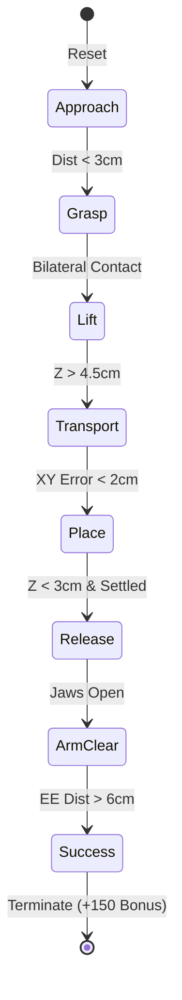

# Phase 6 & 7: Part B2 Pick-and-Place Architecture & Curriculum Design

## 1. Scene & Object Physical Parameterization
- **Robotic Arm**: SO-101 6-DOF (5 arm revolute joints + 1 gripper actuator).
- **Work Table**: $0.70\text{ m} \times 0.70\text{ m}$ table surface positioned at $Z = 0.0\text{ m}$.
- **Cube Dimensions**: $3.0\text{ cm} \times 3.0\text{ cm} \times 3.0\text{ cm}$ ($0.015\text{ m}$ half-size).
- **Domain & Dynamics Randomization**:
  - Cube Mass: Randomized across $25\text{ g}$ to $45\text{ g}$ ($35\text{ g} \pm 30\%$).
  - Table & Cube Friction: Randomized across $\mu \in [0.8, 1.8]$.
  - Cube Starting Pose: Uniformly distributed in $X \in [0.20, 0.32]\text{ m}, Y \in [0.04, 0.16]\text{ m}$.
  - Target Drop Zone: Uniformly distributed in $X \in [0.20, 0.32]\text{ m}, Y \in [-0.16, -0.04]\text{ m}$ ($R_{zone} = 4\text{ cm}$).

---

## 2. Finite-State Sequence & Staged Reward Engineering

The pick-and-place task is governed by 8 distinct sequential diagnostic stages:
1. **APPROACH**: End-effector moves within $3.0\text{ cm}$ of the cube center.
2. **GRASP**: True physical bilateral contact between fixed and moving jaws verified through MuJoCo contact pairs.
3. **LIFT**: Cube lifted above table threshold ($Z > 0.045\text{ m}$).
4. **TRANSPORT**: Spatial displacement of the grasped cube towards the target disc.
5. **PLACE**: Cube aligned within $2.0\text{ cm}$ of target center and lowered to the table.
6. **RELEASE**: Gripper command opens jaws while cube remains settled and stationary ($v_{lin} < 0.04\text{ m/s}$).
7. **ARM CLEAR**: Gripper tip moves $> 6.0\text{ cm}$ away from the placed cube.
8. **SUCCESS**: Simultaneous satisfaction of precision placement ($\le 2.0\text{ cm}$), complete release, arm clearance, and stationary stability.

---

## 3. Physical Grasp Verification vs. Artificial Attachments
In strict accordance with the MUKS Robotics guidelines, **no artificial kinematic constraints or magnetic weld attachments (`<equality><weld>`) are used**. 
- Grasping is verified by parsing `data.contact` manifolds in MuJoCo, checking for simultaneous opposing contact forces between the cube collision geom (`cube_geom`) and the rubber jaw primitives (`fixed_jaw_*` and `moving_jaw_*`).
- If grip force is insufficient or the gripper opens prematurely, gravity immediately causes the cube to drop.

---

## 4. Placement Stability Gating
A placement is only valid if the block has physically settled on the table:
- **Spatial Criterion**: $\|p_{cube}^{xy} - p_{target}^{xy}\| \le 0.020\text{ m}$ ($2.0\text{ cm}$).
- **Velocity Settle Criterion**: Cube linear speed $\|v_{cube}\| \le 0.040\text{ m/s}$ for at least 2 consecutive policy steps.
- **Clearance Criterion**: End-effector retreat distance $\|p_{ee} - p_{cube}\| \ge 0.060\text{ m}$ ($6.0\text{ cm}$).

---

## 5. Curriculum Learning Framework (Levels 1–6)

To accelerate policy convergence over long task horizons without artificial hand-holding:

| Curriculum Level | Focus | Reset Configuration & Environmental Dynamics |
| :--- | :--- | :--- |
| **Level 1** | Approach / Reach | Cube fixed on table; policy learns EE guidance toward cube. |
| **Level 2** | Pre-Grasp & Grip | Gripper initialized hovering $2\text{ cm}$ above cube; learns jaw closure and contact. |
| **Level 3** | Grasp & Lift | Gripper initialized in contact; learns to produce vertical lift without slipping. |
| **Level 4** | Transport | Cube initialized pre-grasped; learns horizontal carry toward a fixed target. |
| **Level 5** | Release & Clearance | Cube initialized held over target zone; learns descent, jaw opening, and retreat. |
| **Level 6 (Full)** | End-to-End Task | Fully randomized cube and target positions, domain-randomized mass and friction. |

During full training, the environment employs an **adaptive curriculum mix**:
- $25\%$ resets spawn in Stage 5 (practicing descent, release, and clearance retreat).
- $30\%$ resets spawn in Stage 2 (practicing approach-to-grasp transitions).
- $45\%$ resets spawn from scratch (full end-to-end task execution).
This ensures all stages of the value function receive dense learning gradients simultaneously.
