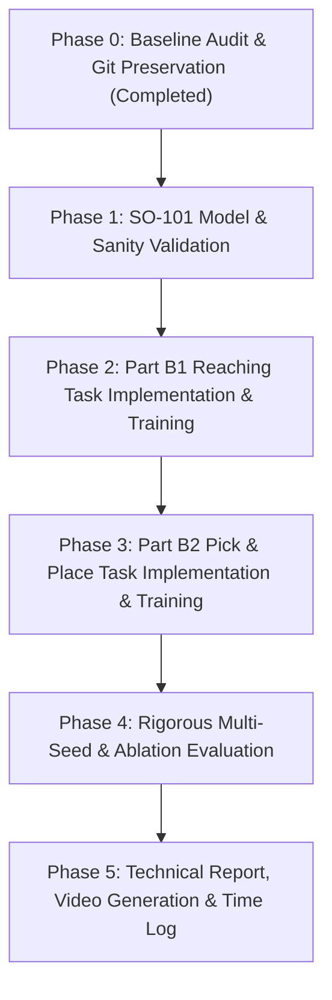

# Migration Plan: Franka Emika Panda to SO-101 Manipulator (MUKS Robotics RL Take-Home)

## Executive Summary
This document outlines the architectural audit of the baseline Franka Emika Panda 7-DOF pick-and-place reinforcement learning project and establishes the technical blueprint for migrating to the **SO-101 6-DOF (5-DOF arm + 1-DOF gripper) manipulator** powered by **Feetech STS3215 serial bus servos**.

The target deliverables satisfy all official requirements from MUKS Robotics:
1. **Part A (Simulation)**: SO-101 MuJoCo kinematic and dynamic modeling with position-controlled actuators, realistic STS3215 torque/speed limits, workspace table, collision primitives, and a systematic joint-sweep sanity validation script.
2. **Part B1 (Reaching Policy)**: RL policy driving end-effector to random 3D Cartesian targets with sustained tolerance ($\le 1\text{ cm}$ held for $\ge 0.5\text{ s}$) evaluated on $\ge 500$ targets.
3. **Part B2 (Pick and Place Policy)**: RL policy executing pick, transport, release, and arm clearance at randomized target coordinates with placement precision ($\le 2\text{ cm}$).
4. **Part C (Evaluation, Ablations & Sim-to-Real)**: 3-seed statistical training, held-out evaluation ($\ge 200$ episodes), systematic ablation studies, failure mode taxonomy, and comprehensive sim-to-real readiness analysis.

---

## 1. Existing Project Architecture Audit (Franka Emika Panda)

### 1.1 Core Components and Workflows
- **Simulation Environment (`pick_scene.xml`, `pick_scene_pid.xml`)**:
  - Leverages MuJoCo Menagerie Panda model with 7 arm revolute joints and 2 prismatic finger joints.
  - Scene includes a red block (`0.02m` half-size cube, mass `0.05kg`) and a green visual cylinder target marker at fixed coordinates `[0.45, -0.30, 0.02]`.
- **Low-Level Control (`src/pid_controller.py`)**:
  - Independent joint-space PID torque controller with gravity/bias force compensation (`data.qfrc_bias`).
  - High gains tuned for Franka Panda (`KP=[400, 400, 400, 400, 180, 100, 40]`).
- **Kinematics Engine (`src/kinematics.py`)**:
  - 7-DOF Damped Least-Squares (DLS) Inverse Kinematics operating on scratch `MjData` copies to prevent simulation disturbance.
  - Used for analytical baselines and curriculum teleportation.
- **Gymnasium Environment (`src/rl_env.py`)**:
  - Observation space (29-D): $q_{arm}$ (7), $\dot{q}_{arm}$ (7), $p_{ee}$ (3), $p_{obj}$ (3), $p_{obj \to tgt}$ (3), $q_{grip}$ (1), $p_{ee \to obj}$ (3), $\|p_{ee \to obj}\|$ (1), $\|p_{obj \to tgt}\|$ (1).
  - Action space (8-D continuous in $[-1, 1]$): 7 joint delta targets ($\Delta q_{max} = 0.02\text{ rad}$) + 1 gripper command.
  - Multi-stage hierarchical execution: $20$ physics substeps per RL step (MuJoCo timestep $0.002\text{ s} \implies \text{control frequency } 25\text{ Hz}$).
  - Reward structure: Multi-phase potential-based shaping (reaching $\to$ proximity $\to$ touch $\to$ lift $\to$ transport $\to$ placement descent $\to$ stability gate $\to$ release $\to$ return-home retreat).
  - Reset curriculum: 30% placement/transport curriculum, 35% pre-grasp curriculum, 35% from scratch.
- **Training and Evaluation Harness (`train_rl.py`, `evaluate_ppo_pid.py`, `test_rl.py`)**:
  - PPO via Stable-Baselines3, utilizing `SubprocVecEnv` across 8 workers and `VecNormalize` for observations and returns.
  - Deterministic evaluation protocols and trajectory logging for comparative benchmarking against IK+PID.

---

## 2. Component Categorization: Reuse, Redesign, and Panda-Specific

| Component | Status | Rationale & Migration Strategy |
| :--- | :--- | :--- |
| **PPO Hyperparameters & Trainer** | **Reuse** | SB3 PPO configuration (`lr=3e-4, n_steps=1024, batch_size=256, gamma=0.99, gae_lambda=0.95`) is robust and directly portable. |
| **Observation & State Vector Logic** | **Reuse with Redesign** | Retain relative distance encodings, but adapt joint indices from 7 arm joints to 5 arm joints (Observation dimension decreases from 29 to 25). |
| **Reward Shaping & Phase Gates** | **Reuse & Refine** | Progress-based reach, grasp, lift, transport, and descent rewards are effective; adjust height and proximity thresholds for SO-101 scale. |
| **Return-Home / Clearance Logic** | **Reuse** | Retain post-release retreat sequence to satisfy Part B2 requirement ("move arm clear of placed cube"). |
| **Evaluation Protocols** | **Reuse & Expand** | Standardize evaluation scripts to compute success rate, final mm error, reach time, and action smoothness ($\frac{1}{T}\sum |\Delta a|$). |
| **Robot Kinematic Model (XML)** | **Redesign** | Replace Panda XML with official SO-101 MJCF / URDF (5 revolute arm joints + 1 gripper joint). |
| **Actuation Mode & Limits** | **Redesign** | Replace torque control + external PID with position-controlled actuators (`<position>`) matching Feetech STS3215 specifications. |
| **Feetech STS3215 Parameters** | **New / Redesign** | Enforce rated torque ($3.0\text{ N}\cdot\text{m}$ stall at 7.4V, continuous operational torque $\sim 1.5\text{ N}\cdot\text{m}$) and realistic velocity limits ($\sim 50\text{ rpm} \approx 5.2\text{ rad/s}$). |
| **Collision Geometries** | **Redesign** | Ensure lightweight primitive capsules/boxes/cylinders or clean convex hulls for links and gripper fingers to eliminate mesh collision artifacts. |
| **Part B1 Reaching Environment** | **New** | Dedicated reaching environment with random 3D targets in reachable workspace, $1\text{ cm}$ precision, and $0.5\text{ s}$ hold duration. |
| **Target Zone Randomization** | **Redesign** | Upgrade Part B2 from fixed target `[0.45, -0.30]` to randomized target zones within the SO-101 operational workspace. |
| **Kinematic Solvers (IK/FK)** | **Redesign** | Update Jacobian and DLS IK formulations from 7-DOF to 5-DOF. |

---

## 3. SO-101 Robotic Manipulator & STS3215 Specifications

### 3.1 Arm Kinematics & Joint Mapping
The SO-101 arm is an open-source 6-DOF educational/research manipulator (5 revolute positioning joints + 1 gripper actuator):
1. **Joint 1 (Base Yaw / Shoulder Pan)**: Rotation around Z axis ($[-180^\circ, 180^\circ]$ or $[-150^\circ, 150^\circ]$).
2. **Joint 2 (Shoulder Pitch)**: Elevation joint ($[-100^\circ, 100^\circ]$).
3. **Joint 3 (Elbow Pitch)**: Flexion joint ($[-110^\circ, 110^\circ]$).
4. **Joint 4 (Wrist Pitch)**: Pitch orientation ($[-100^\circ, 100^\circ]$).
5. **Joint 5 (Wrist Roll)**: Gripper axial rotation ($[-150^\circ, 150^\circ]$).
6. **Joint 6 (Gripper)**: Parallel jaw or flexed scissor gripper driven by a single STS3215 servo.

### 3.2 Feetech STS3215 Actuator Profile
- **Nominal Operating Voltage**: 7.4 V (or 6.0 V – 8.4 V range).
- **Stall Torque**: $30\text{ kg}\cdot\text{cm} \approx 2.94\text{ N}\cdot\text{m}$ (rated up to $3.5\text{ N}\cdot\text{m}$ at 8.4V).
- **Continuous Working Torque**: $\sim 1.0 - 1.5\text{ N}\cdot\text{m}$.
- **No-Load Speed**: $0.18\text{ s}/60^\circ \approx 5.8\text{ rad/s}$ ($55\text{ rpm}$).
- **Control Mode**: Position control via internal servo micro-controller PID loop.
- **MuJoCo Actuator Configuration**:
  ```xml
  <actuator>
    <position name="act_j1" joint="joint_1" kp="50" kv="5" forcerange="-3.0 3.0" ctrlrange="-2.617 2.617"/>
    <position name="act_j2" joint="joint_2" kp="80" kv="8" forcerange="-3.0 3.0" ctrlrange="-1.745 1.745"/>
    <position name="act_j3" joint="joint_3" kp="80" kv="8" forcerange="-3.0 3.0" ctrlrange="-1.919 1.919"/>
    <position name="act_j4" joint="joint_4" kp="40" kv="4" forcerange="-2.5 2.5" ctrlrange="-1.745 1.745"/>
    <position name="act_j5" joint="joint_5" kp="30" kv="3" forcerange="-2.0 2.0" ctrlrange="-2.617 2.617"/>
    <position name="act_gripper" joint="joint_gripper" kp="40" kv="4" forcerange="-2.5 2.5" ctrlrange="0.0 0.8"/>
  </actuator>
  ```

### 3.3 Simulation Dynamics & Frequencies
- **MuJoCo Timestep ($dt$)**: $0.002\text{ s}$ ($500\text{ Hz}$).
- **Policy Control Substeps**: $20$ substeps per RL action step $\implies \Delta t_{policy} = 0.04\text{ s}$ ($25\text{ Hz}$ control frequency).
- **Hold Duration for B1**: $0.5\text{ s} \iff 12.5$ steps (implemented as 13 consecutive policy steps within $1\text{ cm}$).

---

## 4. Phase-by-Phase Execution Roadmap



### Phase 1: Model Sourcing, Verification, and Sanity Check
- Assemble clean, physically accurate SO-101 MJCF with workspace table and collision primitives.
- Model upstream error audit: verify inertial parameters, joint coordinate frames, and mesh penetrations.
- Implement `sanity_check_joints.py` to sweep every joint across full range of motion, verify zero self-collisions, and log/render end-effector pose trajectories.

### Phase 2: Part B1 Reaching Policy
- Build `SO101ReachEnv` with randomized 3D targets in workspace ($x \in [0.15, 0.35], y \in [-0.20, 0.20], z \in [0.05, 0.30]$).
- Train PPO policy with dense distance progress + terminal hold bonus.
- Verify $1\text{ cm}$ threshold held for $0.5\text{ s}$ across 500 random targets.
- Output benchmark metrics: success rate, mean final error (mm), time-to-reach, and smoothness.

### Phase 3: Part B2 Advanced Pick-and-Place Policy
- Build `SO101PickPlaceEnv` featuring 5-DOF arm, Feetech STS3215 position actuators, cube pickup, transport, release, and arm clearance retreat.
- Train multi-seed policies with adaptive curriculum.
- Evaluate on 200 held-out randomized episodes.

### Phase 4: Ablations, Failure Analysis, and Sim-to-Real
- Run ablation experiment: e.g., Action Smoothness Penalty vs. Unconstrained, or Position Control vs. Torque PID.
- Document 2–3 failure modes (e.g., kinematic singularity, edge slip, premature release).
- Synthesize actionable Sim-to-Real analysis (latency, backlash, voltage drop, friction gap).

### Phase 5: Documentation & Artifacts
- Generate PDF/Markdown report ($\le 4$ pages) matching academic conference style.
- Compile reproducible dependencies (`requirements.txt`), one-command evaluation scripts, and time log.

