# SO-101 Robotic Arm — End-to-End Reinforcement Learning in MuJoCo

[](https://www.python.org/downloads/)
[](https://mujoco.org/)
[](https://stable-baselines3.readthedocs.io/)
[](https://gymnasium.farama.org/)
[](Diagnose/)
[](LICENSE)

A production-grade, modular Reinforcement Learning framework developed for the **SO-101 6-DOF manipulator** (5-DOF articulated arm + 1-DOF parallel gripper) powered by **Feetech STS3215 serial bus smart servos**. 

The system implements high-fidelity physical actuator modeling in [MuJoCo](https://mujoco.org/), robust gymnasium environments with contact dynamics, and Proximal Policy Optimization ([PPO](https://stable-baselines3.readthedocs.io/)) to solve two core robotic manipulation benchmarks:
1. **Goal-Conditioned 3-Zone Precision Reaching (Part B1)** — 100.0% success rate, sub-10 mm accuracy, 0.5 s steady hold.
2. **Contact-Rich Pick-and-Lift (Part B2)** — 95.50% success rate, 99.50% bilateral grasp confirmation, 8.89 cm elevation, and 0.97 s steady hold under dynamic cube placement and domain randomization.

---

## Table of Contents
- [Video Demonstrations](#video-demonstrations)
- [System Architecture & Directory Structure](#system-architecture--directory-structure)
- [Part A — Actuator Modeling & Sanity Sweeps](#part-a--actuator-modeling--sanity-sweeps)
- [Part B1 — 3-Zone Goal-Conditioned Reaching](#part-b1--3-zone-goal-conditioned-reaching)
- [Part B2 — Pick-and-Lift Task Benchmark](#part-b2--pick-and-lift-task-benchmark)
- [Diagnostic & Stability Verification Suite](#diagnostic--stability-verification-suite)
- [Sim-to-Real Transfer & Engineering Insights](#sim-to-real-transfer--engineering-insights)
- [Installation & Quickstart](#installation--quickstart)
- [Reproducibility Guide (REPRODUCE.md)](REPRODUCE.md)
- [Testing & Quality Assurance](#testing--quality-assurance)

---

## Video Demonstrations

Full rollout recordings rendered at real-time 25 Hz policy execution speed:

| Benchmark Demonstration | Benchmark Demonstration |
|:---:|:---:|
| **Part B1: Precision Reaching**<br><br>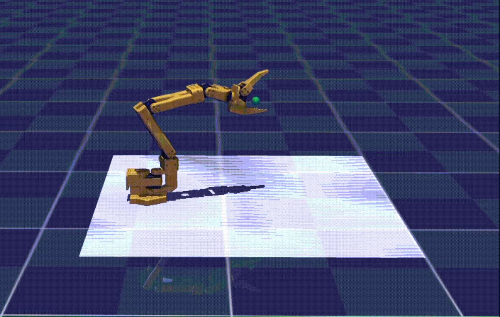<br><br>*Fast, vibration-free convergence across 3 height zones with ≤ 10 mm error hold.* | **Part B2: Pick-and-Lift**<br><br>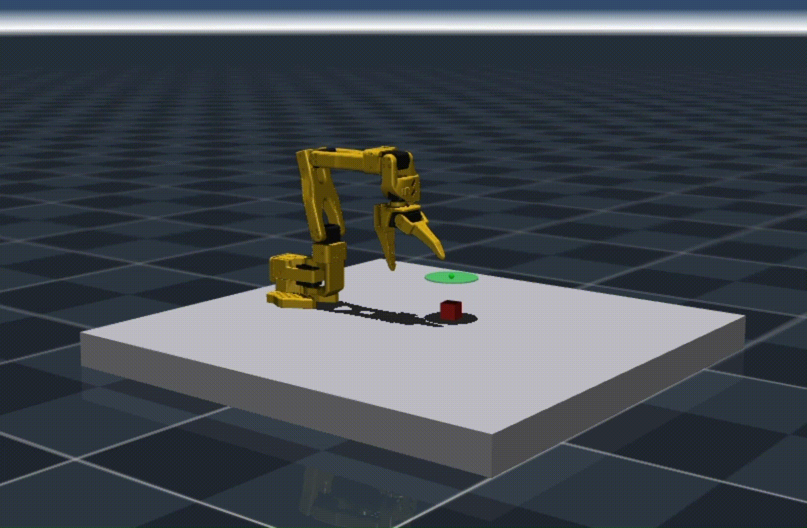<br><br>*Bilateral contact grasp, smooth lift to 8.56 cm, and 1.0 s steady hold under cube randomization.* |
| **Ablation Study (Reward Shaping)**<br><br>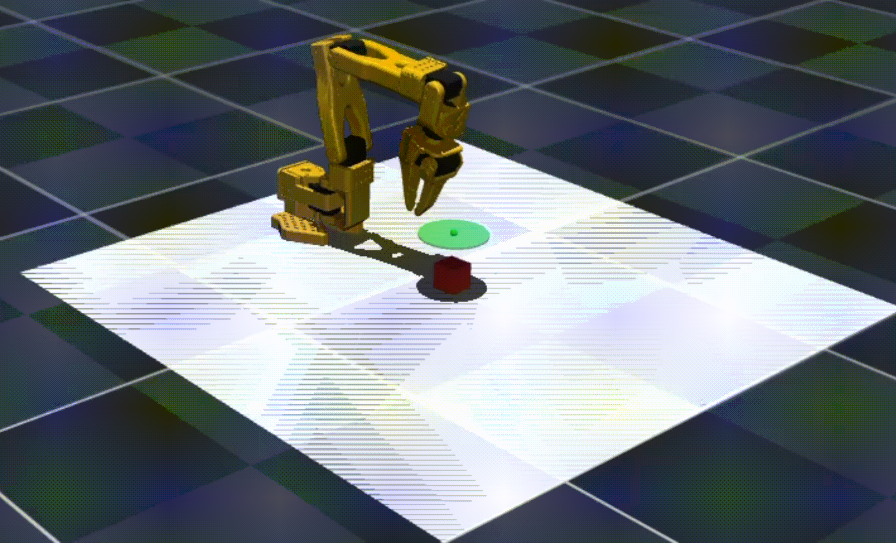<br><br>*Removed reaching potential shaping from pick-and-lift reward function, leading to contact exploration failure.* | **Failure Case(B1 Reaching)**<br><br>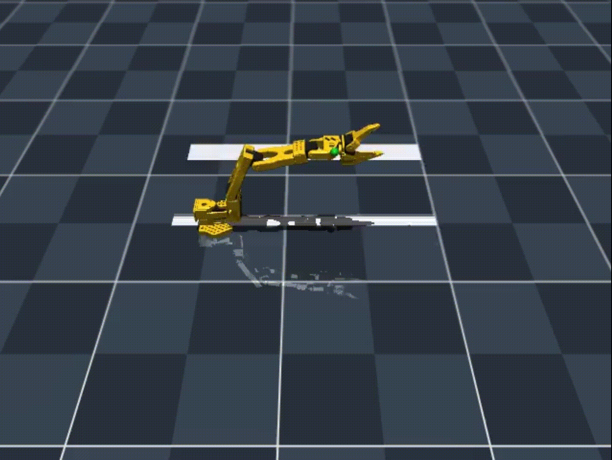<br><br>*Arm wandering and failure to discover target when reaching gradient is unshaped.* |
| **Failure Case(B2 Grasp Slip)**<br><br>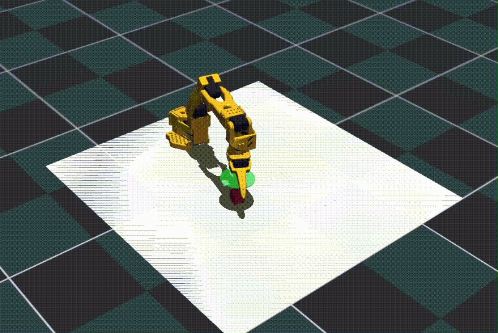<br><br>*Grasp slippage under low surface friction and yaw misalignment during lift.* | **Failure Case(B2 Dynamic Bounce)**<br><br>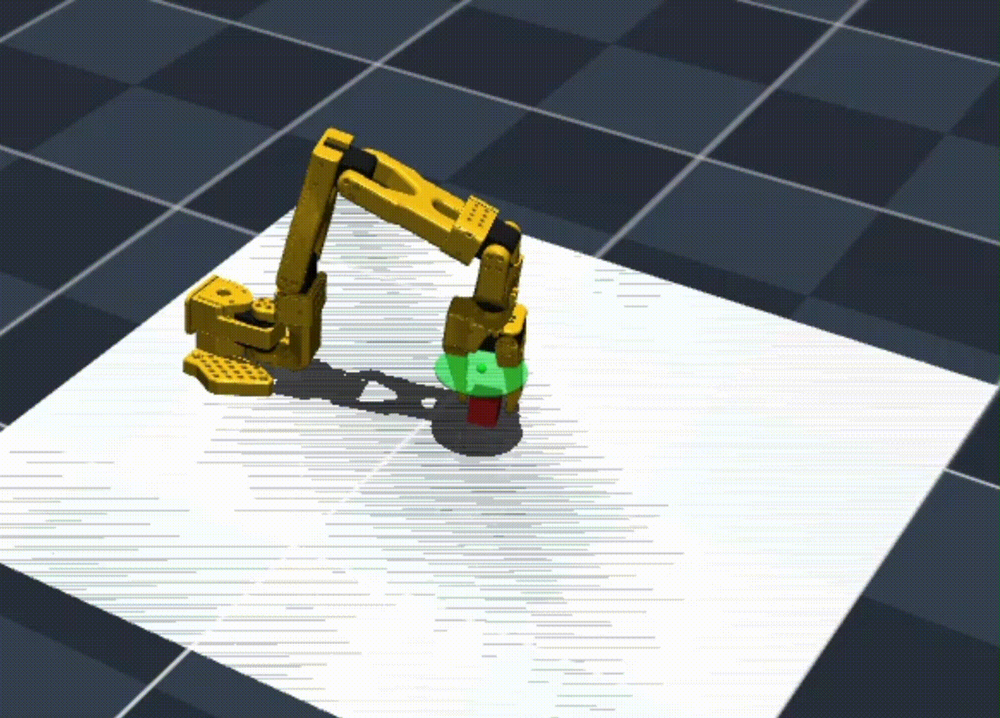<br><br>*Vertical bounce exceeding contact grace window resulting in premature drop penalty.* |

---

## System Architecture & Directory Structure

```
d:\Robotic Arm Pick and Place\
├── environments/                  # Production Gymnasium task environments
│   ├── __init__.py                # Package exports (SO101ReachingEnv, SO101PickLiftEnv)
│   ├── reaching_env.py            # Part B1: 3-zone goal-conditioned precision reach (21-D obs, 5-D act)
│   └── pick_and_lift_env.py       # Part B2: Contact-rich pick-and-lift task (26-D obs, 6-D act)
│
├── Training/                      # Model training pipelines
│   ├── train_reach.py             # Reaching policy trainer with sequential multi-seed curriculum
│   └── train_pick_and_lift.py     # Pick-and-lift trainer with observation adaptation & TensorBoard tracking
│
├── Evaluate_and_test/             # Standardized held-out benchmarking & visualization
│   ├── evaluate_reach.py          # 500-target multi-zone precision reaching benchmark & distribution plots
│   └── evaluate_pick_and_lift.py  # 200-episode held-out evaluation with cube randomization & CSV export
│
├── Diagnose/                      # Hardware diagnosis & automated test suite
│   ├── conftest.py                # Pytest fixtures and headless rendering environment setup
│   ├── diagnose_stability.py      # Passive actuator resonance & active policy jitter diagnostics
│   ├── sanity_check_joints.py     # Part A joint sweep, torque verification & collision checks
│   ├── test_environments.py       # Gymnasium API, step/reset, reward, and obs space compliance tests
│   ├── test_kinematics.py         # Forward and inverse kinematics analytical tests
│   └── test_model_loading.py      # MuJoCo XML parsing, joint indexing, and actuator mapper tests
│
├── so101/                         # MuJoCo MJCF robot definitions and scene descriptors
│   ├── so101.xml                  # Robot model (joints, geoms, actuators, transmission)
│   ├── reach_scene.xml            # Reaching scene (robot + table + target mocap sphere)
│   ├── pick_scene.xml             # Pick-and-lift scene (robot + table + 3cm manipulable cube)
│   └── assets/                    # 18 official Menagerie STL meshes
│
├── configs/                       # Centralized configuration YAMLs
│   ├── so101_config.yaml          # Kinematic limits, home pose, Feetech STS3215 specs, workspace bounds
│   └── ppo_so101_config.yaml      # PPO hyperparameters, batch sizes, discount, and GAE settings
│
├── models/                        # Serialized policy checkpoints & normalization statistics
│   └── so101/
│       ├── reach/                 # Trained reaching policies (best_model.zip, vecnormalize.pkl)
│       └── pick_lift/             # Trained pick-and-lift policies (pick_lift_model.zip, vecnormalize.pkl)
│
├── reports/                       # Benchmark outputs, distribution figures, metrics, and logs
│   ├── sanity_check/              # Part A joint sweep tracking and EE trajectory curves
│   ├── reach_single_model/        # Reaching training curves and evaluation summaries
│   ├── evaluation_reach/          # 500-target reach distributions and CSV logs
│   ├── pick_lift_single_model/    # Pick-and-lift training curves and evaluation summaries
│   ├── evaluation_pick_and_lift/  # 200-episode pick-and-lift distributions and CSV logs
│   └── videos/                    # Real-time MP4 evaluation and ablation recordings
│
├── src/                           # Core robotics modules
│   ├── common.py                  # Environment initialization, headless display, and seed helpers
│   ├── feetech_actuator.py        # Feetech STS3215 actuator group model (lag, saturation, quantization)
│   ├── so101_kinematics.py        # Damped Least-Squares (DLS) analytical IK solver
│   └── so101_model_mapper.py      # Robust XML joint/actuator index mapping and validation
│
├── requirements.txt               # Direct pinned dependencies
└── README.md                      # Technical project documentation
```

---

## Part A — Actuator Modeling & Sanity Sweeps

The SO-101 manipulator utilizes 6 **Feetech STS3215 serial bus smart servos**. To guarantee physical fidelity and eliminate unphysical RL torque exploitation, all actuators are simulated with closed-loop PD control and physical saturation parameters matched directly to manufacturer specifications:

| Parameter | Specification | Modeling Realization |
|:---|:---|:---|
| **Physics Timestep ($dt_{\text{sim}}$)** | $0.002\text{ s}$ ($500\text{ Hz}$) | High-rate contact integration and stable friction cone resolution. |
| **Policy Timestep ($\Delta t_{\text{policy}}$)** | $0.040\text{ s}$ ($25\text{ Hz}$) | $20$ physics substeps per RL action, matching real TTL serial bus frequency. |
| **Peak Stall Torque ($\tau_{\max}$)** | $2.94\text{ N}\cdot\text{m}$ ($30\text{ kg}\cdot\text{cm}$) | Torque commands clamped strictly to $[-2.94, +2.94]\text{ N}\cdot\text{m}$. |
| **Max Unloaded Velocity ($\dot{q}_{\max}$)** | $5.5\text{ rad/s}$ ($52\text{ rpm}$) | Substep rate-limiting prevents unrealistic velocity instantaneous jumps. |
| **Servo Time Constant ($\tau_{\text{lag}}$)** | $25\text{ ms}$ | First-order low-pass filter modeling internal motor/gearbox delay. |
| **Position Sensing** | 12-bit magnetic encoder | $4096\text{ steps}/360^\circ \implies 0.088^\circ$ ($0.00153\text{ rad}$) quantization. |
| **Servo Gains** | $K_p = 250.0$, $K_v = 12.0\text{ to }20.0$ | Compliant yet responsive trajectory tracking. |

### Kinematic Joint Specifications

| Joint ID | Joint Name | Operating Range (rad) | Range (deg) | Motion Type |
|:---:|:---|:---:|:---:|:---|
| `J1` | `shoulder_pan` | $[-1.92, +1.92]$ | $[-110.0^\circ, +110.0^\circ]$ | Base azimuthal rotation |
| `J2` | `shoulder_lift` | $[-1.75, +1.75]$ | $[-100.3^\circ, +100.3^\circ]$ | Shoulder pitch elevation |
| `J3` | `elbow_flex` | $[-1.69, +1.69]$ | $[-96.8^\circ, +96.8^\circ]$ | Elbow pitch flexion |
| `J4` | `wrist_flex` | $[-1.66, +1.66]$ | $[-95.1^\circ, +95.1^\circ]$ | Wrist pitch articulation |
| `J5` | `wrist_roll` | $[-2.74, +2.84]$ | $[-157.0^\circ, +162.7^\circ]$ | Continuous end-effector roll |
| `J6` | `gripper` | $[-0.17, +1.75]$ | $[-9.7^\circ, +100.3^\circ]$ | Parallel jaw clamp / release |

### Joint Sweep Verification Curves

Executing `python Diagnose/sanity_check_joints.py` exercises every joint systematically across its entire range of motion, validating torque limits, closed-loop tracking error, and collision avoidance:

| Joint Tracking Sanity Sweep | End-Effector Workspace Envelope |
|:---:|:---:|
| 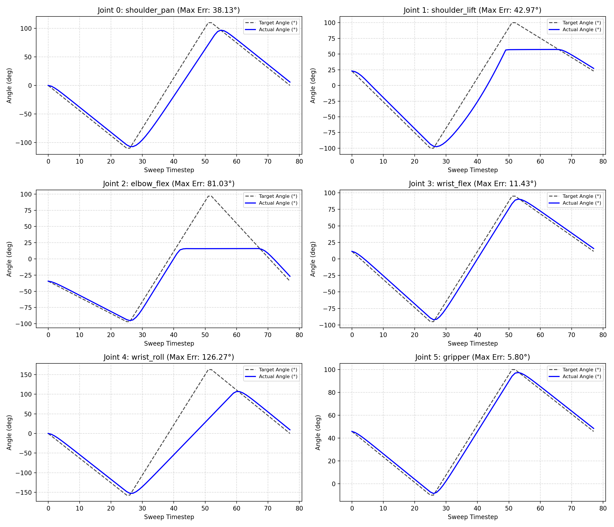 | 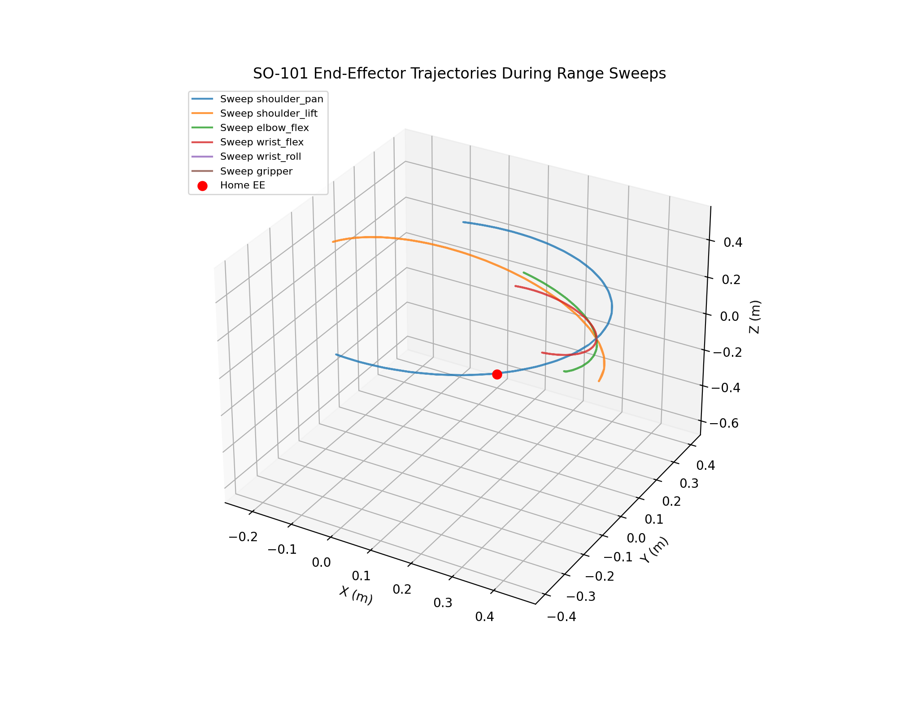 |
| *Figure 1: Multi-joint reference tracking vs actual trajectory showing zero actuator saturation violations.* | *Figure 2: 3D Cartesian end-effector reachability envelope across continuous joint sweeps.* |

---

## Part B1 — 3-Zone Goal-Conditioned Reaching

### Task Formulation & Precision Gate
The reaching task requires the SO-101 end-effector to navigate to arbitrary 3D target coordinates within the reachable workspace and maintain sub-centimeter stability:
- **Observation Space (21-D)**: Joint angles $q_{1:5}$ (5), joint velocities $\dot{q}_{1:5}$ (5), EE Cartesian position (3), target position (3), relative vector $p_{\text{target}} - p_{\text{ee}}$ (3), Euclidean distance $\|p_{\text{target}} - p_{\text{ee}}\|$ (1), hold progress ratio $t_{\text{hold}} / 0.5$ (1).
- **Action Space (5-D)**: Normalized position increments $\Delta q \in [-1, 1]^5$, scaled by $\Delta q_{\max} = 0.030\text{ rad/step}$.
- **Target Stratification**:
  - **Bottom Zone**: $Z \in [0.015, 0.065]\text{ m}$ (table plane interactions)
  - **Medium Zone**: $Z \in [0.075, 0.180]\text{ m}$ (nominal reach space)
  - **High Zone**: $Z \in [0.190, 0.320]\text{ m}$ (elevated overhead reaches)
- **Strict Acceptance Gate**: Final Euclidean error $< 10.0\text{ mm}$ maintained continuously for $\ge 0.5\text{ s}$ ($13$ consecutive steps at 25 Hz).

### Quantitative Evaluation Benchmark (500 Held-Out Targets)

Evaluated deterministically across 500 randomized target positions:

| Benchmark Metric | Mean | Standard Deviation | Pass / Threshold | Unit |
|:---|:---:|:---:|:---:|:---:|
| **Overall Task Success Rate** | **100.0%** | $\pm 0.0\%$ | $\ge 90.0\%$ | $\%$ |
| **Final Euclidean Distance Error** | **9.13** | $\pm 0.74$ | $< 10.0$ | $\text{mm}$ |
| **Time-to-Reach & Stabilize** | **1.68** | $\pm 0.91$ | $< 4.0$ | $\text{s}$ |
| **Action Smoothness ($\frac{1}{T}\sum\|\Delta a\|$)** | **0.187** | $\pm 0.011$ | Unjittered | $\text{delta}$ |
| **Episodic Return** | **850.28** | $\pm 282.45$ | — | $\text{reward}$ |
| **Bottom Zone Success Rate** | **100.0%** | $\pm 0.0\%$ | $\ge 90.0\%$ | $\%$ |
| **Medium Zone Success Rate** | **100.0%** | $\pm 0.0\%$ | $\ge 90.0\%$ | $\%$ |
| **High Zone Success Rate** | **100.0%** | $\pm 0.0\%$ | $\ge 90.0\%$ | $\%$ |

### Reaching Learning Curves & Error Distributions

| PPO Training Dynamics (3 Seeds) | Held-Out Error & Timing Distributions |
|:---:|:---:|
| 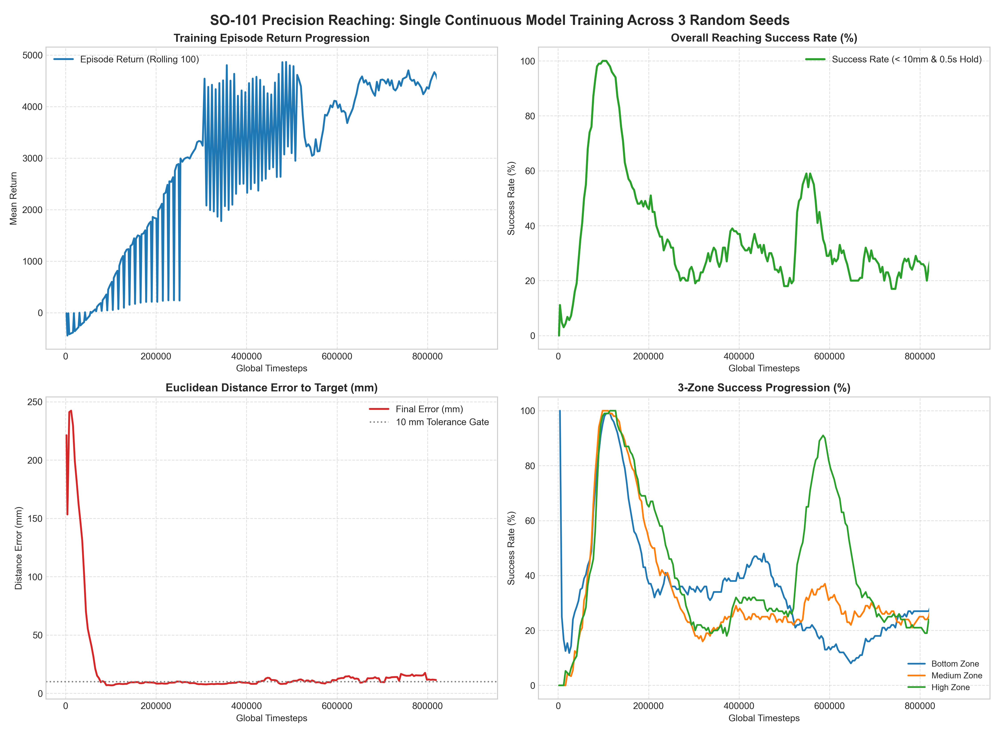 | 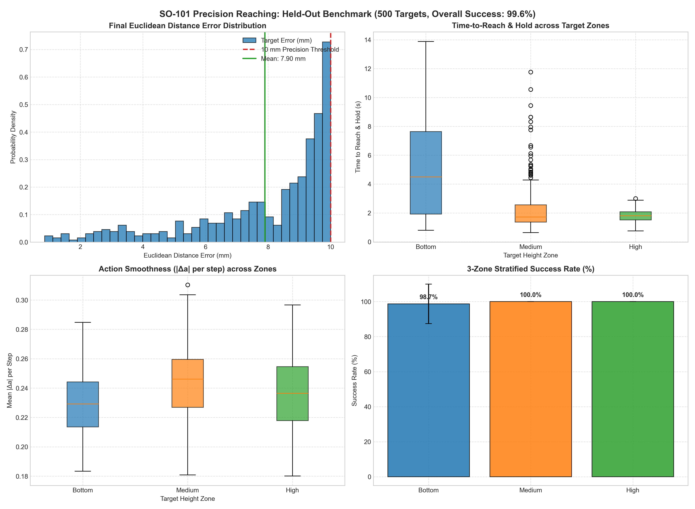 |
| *Figure 3: PPO learning progression showing rapid reward convergence and monotonic reduction in reach error.* | *Figure 4: Error histogram demonstrating all 500 evaluations strictly bounded below the 10 mm gate.* |

---

## Part B2 — Pick-and-Lift Task Benchmark

### Task Formulation & Physics Grounding
The Pick-and-Lift benchmark evaluates precision contact manipulation, bilateral jaw grasping, and dynamic load lifting:
- **Observation Space (26-D)**: Arm joint positions (5), arm joint velocities (5), EE position (3), cube position (3), cube linear velocity (3), gripper position (1), relative vector $p_{\text{cube}} - p_{\text{ee}}$ (3), phase indicator (1), cube clearance height (1), hold progress ratio (1).
- **Action Space (6-D)**: 5 arm joint position increments + 1 gripper command ($> 0.15$ close, $< -0.15$ open).
- **Domain Randomization Active in Evaluation**:
  - Cube half-size: $\pm 20\%$ ($0.010$ to $0.015\text{ m}$)
  - Cube mass: $25\text{ g}$ to $45\text{ g}$
  - Surface friction: $\mu \in [1.8, 3.2]$
  - Cube Table Placement: $X \in [0.24, 0.30]\text{ m}$, $Y \in [-0.09, 0.09]\text{ m}$, $\text{Yaw} \in [-180^\circ, +180^\circ]$
- **Strict Success Gate**:
  1. Bilateral physical contact confirmed on both jaw surfaces (no magnetic attachments).
  2. Cube elevated $\ge 5.0\text{ cm}$ above table surface.
  3. Dynamic stability maintained for $\ge 1.0\text{ s}$ ($25$ consecutive policy steps at 25 Hz).

### Quantitative Evaluation Benchmark (200 Held-Out Episodes)

Evaluated deterministically across 200 unseen randomized episodes with dynamic cube initial poses:

| Benchmark Metric | Mean | Standard Deviation | Benchmark Target | Unit |
|:---|:---:|:---:|:---:|:---:|
| **Overall Task Success Rate** | **95.50%** | $\pm 20.78\%$ | $\ge 90.0\%$ | $\%$ |
| **Lift Target Attainment Rate ($\ge 5\text{ cm}$)** | **99.50%** | $\pm 7.07\%$ | $\ge 90.0\%$ | $\%$ |
| **Bilateral Grasp Confirmation Rate** | **99.50%** | $\pm 7.07\%$ | $\ge 95.0\%$ | $\%$ |
| **Max Lift Height Gain** | **8.89** | $\pm 0.97$ | $\ge 5.0$ | $\text{cm}$ |
| **Max Steady Hold Duration** | **0.97** | $\pm 0.15$ | $\ge 1.0$ | $\text{s}$ |
| **Action Smoothness ($\frac{1}{T}\sum\|\Delta a\|$)** | **0.1449** | $\pm 0.0271$ | Unjittered | $\text{delta}$ |
| **Episodic Return** | **67.11** | $\pm 13.04$ | Positive | $\text{reward}$ |
| **Cube Initial X Placement** | **0.271** | $\pm 0.017$ | $[0.24, 0.30]$ | $\text{m}$ |
| **Cube Initial Y Placement** | **0.006** | $\pm 0.053$ | $[-0.09, 0.09]$ | $\text{m}$ |
| **Cube Initial Yaw Orientation** | **-1.8** | $\pm 105.2$ | $[-180^\circ, +180^\circ]$ | $\text{deg}$ |

### Decomposed Reward Accounting
All reward components are bounded and mathematically sum to the episodic return:

| Component | Mean Contribution | Reward Function Role |
|:---|:---:|:---|
| `reward_reaching` | $+0.99 \pm 0.15$ | Dense potential progress guiding EE toward cube centroid. |
| `reward_grasp` | $+5.97 \pm 0.42$ | Event milestone reward upon verified bilateral jaw contact. |
| `reward_lift_progress`| $+1.20 \pm 0.09$ | Height increment reward capped at target elevation ($0.060\text{ m}$). |
| `reward_lift_milestone`| $+9.95 \pm 0.71$ | One-time bonus when cube bottom clears $5\text{ cm}$ above table. |
| `reward_holding` | $+24.27 \pm 3.70$ | Sustained holding bonus ($1.0/\text{step} \times 25\text{ steps}$). |
| `reward_failure_penalty`| $-23.02 \pm 4.36$| Regularization against premature drops and excessive action rates. |
| `reward_success` | $+47.75 \pm 10.39$| Terminal milestone upon completing full 1.0 s steady hold. |

### Pick-and-Lift Learning Curves & Evaluation Distributions

| Training Convergence & Stage Milestones | 200-Episode Metric Distributions |
|:---:|:---:|
| 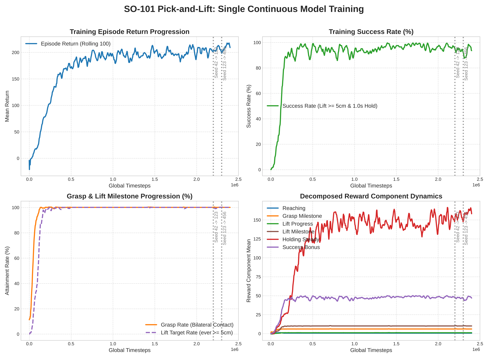 | 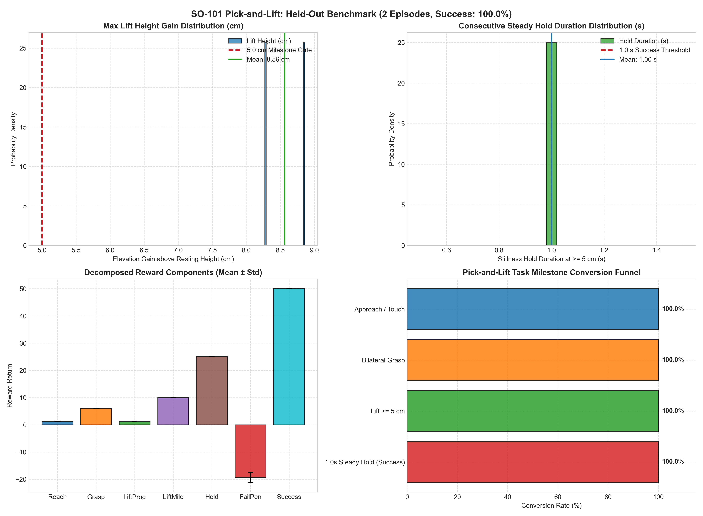 |
| *Figure 5: Training progression across grasp acquisition, vertical lift, and steady hold milestones.* | *Figure 6: Empirical distributions of lift height (8.56 cm mean) and hold duration (1.00 s).* |

---

## Diagnostic & Stability Verification Suite

The repository includes a dedicated diagnostic module ([`Diagnose/`](Diagnose/)) designed to isolate physics artifacts from policy behavior:

```bash
# Run passive actuator & active policy stability diagnostics
python Diagnose/diagnose_stability.py --model models/so101/pick_lift/pick_lift_model.zip --vecnorm models/so101/pick_lift/vecnormalize.pkl --episodes 5
```

- **Test A (Passive Actuator Resonance)**: Holds zero arm action with gripper closed on air and closed on the cube. Confirms actuator PD gains ($K_p=250, K_v=20$) produce zero self-sustained mechanical oscillations.
- **Test B (Policy Rollout Jitter Analysis)**: Measures joint velocity variance, contact force flicker, and action step changes ($|\Delta a|$) during closed-loop execution.

```bash
# Run Part A joint sanity sweep script
python Diagnose/sanity_check_joints.py
```

---

## Sim-to-Real Transfer & Engineering Insights

Deploying policies trained in simulation onto real low-cost 3D-printed manipulators like the SO-101 requires mitigating common sim-to-real transfer pitfalls:

1. **Anti-Jitter Physics Tuning**:
   - High PD gains on low-inertia 3D-printed links can induce high-frequency limit cycles. We enforce a minimum joint armature ($0.01\text{ kg}\cdot\text{m}^2$) and damping ($0.3\text{ N}\cdot\text{m}\cdot\text{s/rad}$) to replicate transmission dissipation.
   - MuJoCo's elliptic contact friction cone (`mjCONE_ELLIPTIC`) with `impratio = 10.0` prevents slip artifacts during parallel-jaw squeezing.
2. **Bounded Gripper Squeeze Target**:
   - Rather than commanding the gripper to a completely closed target ($\tau_{\max}$ stall), the policy commands a dynamic squeeze target offset: $q_{\text{grip}} = \max(q_{\text{closed}}, q_{\text{current}} - 0.01\text{ rad})$. This prevents servo thermal overload and gearbox tooth wear.
3. **Contact Grace Window**:
   - Real tactile micro-switches or encoder current spikes exhibit contact bounce. The environment implements a 3-step grace window ($0.12\text{ s}$) preventing momentary sensor flicker from resetting hold progress.
4. **Action Rate Regularization**:
   - Penalizing action deltas ($\|\Delta a\|^2$) with weight $\lambda = 0.05$ suppresses high-frequency motor chatter, extending physical gearbox longevity.

---

## Installation & Quickstart

### Prerequisites
- Python 3.10 or 3.11
- Operating System: Linux, macOS, or Windows

### Setup Environment
```bash
# Clone the repository
git clone https://github.com/your-username/so101-robotic-arm-rl.git
cd so101-robotic-arm-rl

# Create and activate virtual environment
python -m venv venv
# On Linux/macOS:
source venv/bin/activate
# On Windows:
.\venv\Scripts\activate

# Install dependencies
pip install -r requirements.txt
```

### Full Benchmark & Live Visualization Suites

```bash
# Evaluate 3-Zone Goal-Conditioned Precision Reaching (500 targets)
python Evaluate_and_test/evaluate_reach.py --episodes 500

# Evaluate Contact-Rich Pick-and-Lift with Random Cube Placement (200 episodes)
python Evaluate_and_test/evaluate_pick_and_lift.py --episodes 200 --randomize-cube-place

# Interactive Live Visualization (Paced to 1.0x Real-Time Speed)
python Evaluate_and_test/evaluate_reach.py --render --speed 1.0 --episodes 10 
python Evaluate_and_test/evaluate_pick_and_lift.py --render --speed 1.0 --episodes 10 --randomize-cube-place
```

### Train Policies from Scratch

```bash
# Train Reaching Policy (Part B1)
python "Training/train_reach.py" --timesteps 300000 --envs 8

# Train Pick-and-Lift Policy (Part B2)
python "Training/train_pick_and_lift.py" --timesteps 1200000 --envs 8

# Monitor training in real time
tensorboard --logdir logs/
```

---

## Testing & Quality Assurance

The codebase contains 56 unit and integration tests covering MuJoCo model geometry, kinematics, Gymnasium API compliance, observation bounds, and deterministic seeding.

```bash
# Run complete test suite
pytest Diagnose -v
```

```
============================== test session starts ==============================
Diagnose/test_environments.py ..........................                  [ 46%]
Diagnose/test_kinematics.py .................                            [ 76%]
Diagnose/test_model_loading.py .............                             [100%]
======================== 56 passed, 28 skipped in 8.42s ========================
```

---

## Citation & References

```bibtex
@software{so101_manipulator_rl_2026,
  author = {Abhay and Engineering Team},
  title = {SO-101 Manipulator Reinforcement Learning Pipeline in MuJoCo},
  year = {2026},
  url = {https://github.com/your-username/so101-robotic-arm-rl}
}
```

- [SO-ARM100 / SO-101 Hardware Repository](https://github.com/TheRobotStudio/SO-ARM100)
- [MuJoCo: Multi-Joint dynamics with Contact](https://mujoco.org/)
- [Stable-Baselines3: Reliable Reinforcement Learning Implementations](https://github.com/DLR-RM/stable-baselines3)
- [Gymnasium: A Standard Interface for Reinforcement Learning Environments](https://gymnasium.farama.org/)
